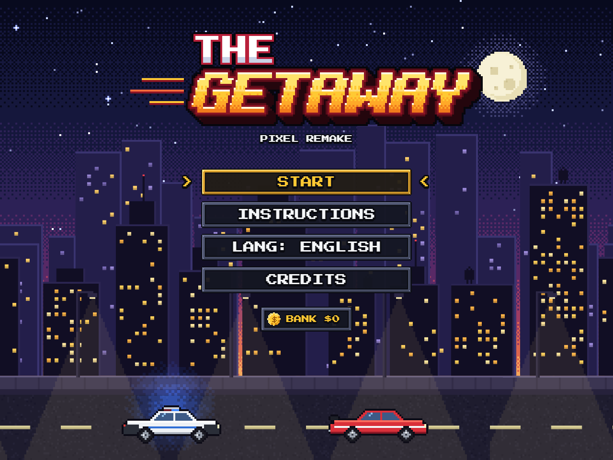
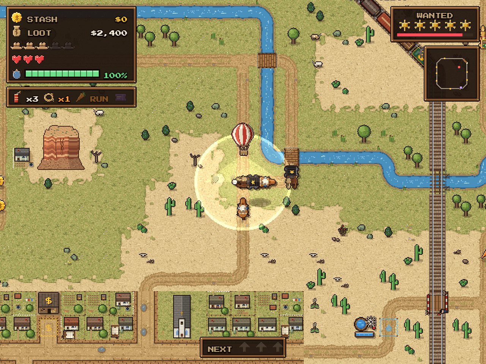
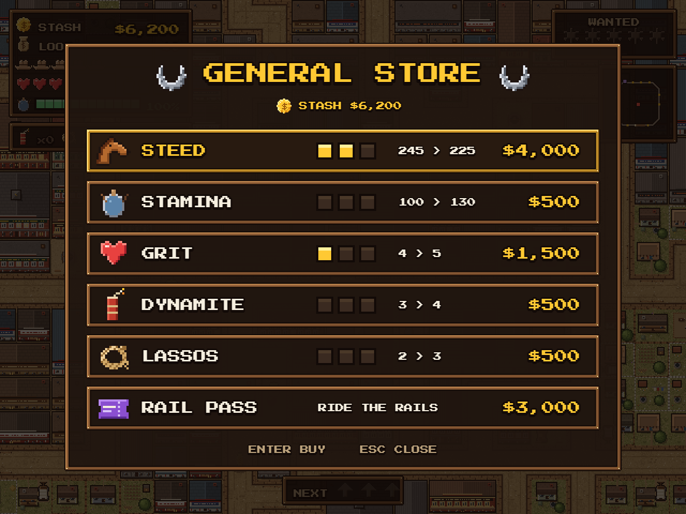
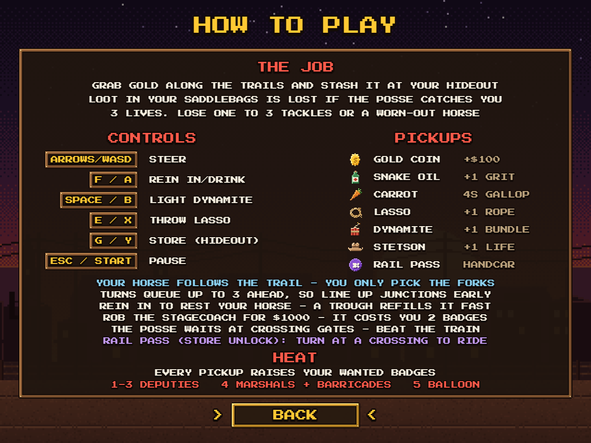

# The Getaway

A pixel-art Wild West getaway game. You ride an outlaw's paint horse through a
procedurally generated frontier town, grab gold off the streets, and stash it
at your hideout before the posse runs you down.

Built with [Phaser 3](https://phaser.io/) and [Vite](https://vite.dev/).

**Play it:** https://zednicek-adam.github.io/Getaway/

| | |
| --- | --- |
|  |  |
|  |  |

## The loop

Gold you pick up is **loot** in your saddlebags, not money earned. Loot is lost
when the posse catches you. It only counts once you ride it back to your
hideout (the gold `$` pad) and stash it.

Every pickup raises your **heat**, and heat earns you sheriff's badges on the
WANTED poster:

| Badges | Response |
| ------ | -------- |
| 0 | Nobody's looking for you |
| 1–2 | Deputies ride you down when you're close, otherwise head for where you were last seen |
| 3 | Three deputies riding straight at you |
| 4 | The marshals' prison wagon joins; barricades go up ahead of you |
| 5 | A second wagon and an army observation balloon that pins you in its limelight and slows you down |

Stashing your loot ends the chase immediately. Otherwise the chase runs on a
20-second countdown that refuses to tick below 25% while a deputy can see you.
You have to actually break line of sight, not just outlast it. Once the chase
ends, badges fade one every five seconds. The posse fires warning shots into
the air while they ride; the shots are only for show.

Your stash persists between runs in `localStorage` and is spent at the general
store.

### Losing

You have three lives (the spare hats on the HUD). You lose one when the posse
tackles you down to your last heart of **grit** (three tackles by default) or
when your horse runs out of **stamina**. Either way, your loot is gone.

Your horse tires as it runs. Rein in anywhere and it slowly gets its wind back;
stop at a water trough (the blue pads) and it drinks its fill in a few seconds.

## Controls

| Key | Gamepad | Action |
| --- | ------- | ------ |
| Arrows / WASD | D-pad / left stick | Steer (queues up to 3 turns ahead) |
| `F` | A | Rein in: hold position and rest, or drink when parked at a trough |
| `Space` | B / LT | Light a bundle of dynamite (10s fuse, blows up the posse) |
| `E` | X / RT | Throw a lasso along your facing, up to 6 tiles |
| `G` | Y | Open the general store (only while parked on the hideout pad) |
| `Esc` | Start | Pause |

Gamepad buttons follow the Xbox layout; on a PlayStation pad A is Cross, B
Circle, X Square and Y Triangle. The pad also drives every menu: D-pad or stick
to move, A to pick, B to back out. Any controller the browser exposes through
the standard Gamepad API works, and the browser only reveals it after a button
press, so press one first if it doesn't respond. On-screen prompts switch to pad
buttons once a controller is connected.

Touch devices can swipe to steer. A HOW TO PLAY page shows this same summary
in-game, reachable from both the title screen and the pause menu; opening it
from pause leaves the run paused and returns you there. The pause menu can also
drop you back to the title screen.

Your horse runs on its own; you only choose the turns. Because turns are
buffered, you can line up a sequence through a junction before you reach it.

## Pickups

Gold is the bulk of what turns up on the streets; the rest is rarer.

| Sprite | Pickup | Effect |
| ------ | ------ | ------ |
| spinning gold `$` coin | Gold | +$100 loot, +1 heat |
| green bottle, red cross | Snake oil | Heals one heart of grit |
| carrot | Carrot | Your horse gallops ~1.5× faster for 4 seconds |
| coiled rope | Lasso | +1 lasso |
| red sticks, lit fuse | Dynamite | +1 bundle |
| cowboy hat | Stetson | +1 life, capped at 5 |
| purple ticket token | Rail pass | Ride the rails on a handcar once (only appears after the store unlock) |

There is also a **stagecoach** (red and gold, a strongbox on its roof) rolling
around town. Ride into it to rob it of $1,000, but it costs you two badges on
the spot.

A lasso that catches a deputy yanks him out of the saddle (his hat goes flying)
and he's out of the chase until a replacement rides in. The marshals' wagon
shrugs off the first rope. A lasso that lands on a barricade pulls it apart.

## The railroad

A railroad loops around town, about nine tiles in from the map edges, and one
steam train runs it nonstop at twice the base speed of your horse. The corners
are cut at 45 degrees, so the loop is an octagon. Main Street and your hideout
sit inside it and the outskirts outside it.

Streets only cross the track at **planked crossings**. Three seconds before the
train reaches a crossing, the engineer blows the whistle, the lanterns flash
and the gates swing down. They stay down until the last car has cleared.
Anything the moving train runs into is wrecked:

| Hit | Result |
| --- | ------ |
| You | A life and your loot, whatever your grit |
| Deputies / marshals' wagon | Out of the chase, replaced after the usual delay |
| Stagecoach | Smashed; the strongbox is left on the street for you to grab |

The posse never rides through lowered gates, and while they're held on the
other side of the loop they can't see you. Cross just before the train and the
chase countdown keeps running down while they wait or look for another way
round.

**Rail pass.** A one-time store unlock ($3,000) adds rail passes to the pickups.
With one in hand, turn off a crossing onto the track: the pass is spent, the
outlaw jumps onto a pump handcar that follows the rails on its own, and no one
in the posse can follow you. Turn onto the street at any crossing to get off.
Getting back on takes another pass. The train is on the same loop, so watch the
loop map in the top-right corner. The posse waits for you beside the crossings
ahead.

**Express car heist.** The train stops at the depot (the purple pad beside the
track) every lap. Every third lap the vault in its green express car is open for
eight seconds. Park on the platform pad and each second pays $250 loot and adds
1 heat. Staying the whole eight seconds is $2,000 and three badges.

## The general store

Park on the hideout pad and press `G`. Five upgrade tracks, three levels each,
costing $500 / $1,500 / $4,000 out of your stash:

| Track | Level 0 → 3 |
| ----- | ----------- |
| Steed | 300ms → 225ms per tile |
| Stamina | 100 → 200 |
| Grit | 3 → 6 hearts |
| Dynamite | 3 → 6 bundles |
| Lassos | 2 → 5 lassos |

Upgrades apply mid-run and persist across runs. Below the tracks is the one-time
**rail pass** unlock ($3,000), which makes rail passes turn up on the streets.

## Running it locally

Requires Node 20+.

```bash
npm install
npm run dev      # dev server
npm run build    # production build into dist/
npm run preview  # serve the built output
npm test         # vitest unit tests
```

Note that `vite.config.js` sets `base: '/Getaway/'` for GitHub Pages, so the dev
server and preview serve the game at `/Getaway/` rather than `/`. Vite prints the
full URL on startup.

## How the map is built

The railroad loop is laid out first, with a few crossing points picked on each
straight side. `NetworkGenerator` treats the rest of the track as a wall and
seeds every crossing as a short street stub straight through it. Then it grows
a street network outward from the player's spawn using a growing-tree walk,
rather than stamping a grid. It guarantees full connectivity, balanced growth
across all four quadrants, junctions at least 3 tiles apart, and no dead ends
except the spawn tile, so every street you can turn onto actually goes
somewhere. Crossings the network never connected on both sides are pruned back
to track. `MapManager` then places the hideout, the depot (beside a straight
stretch of track, clear of crossings) and three water troughs on reachable,
well-spaced pads and auto-tiles the streets.

Generation retries (up to 50 attempts) if a layout fails its reachability check
or keeps fewer than five crossings.

The logic grid only knows *road* and *not road*. `cityLayout.js` decides what
that looks like. Street cells pick one of 47 autotiles from their neighbours,
and the streets carry their own boardwalks (hitching rails and barrels
included), so the buildings behind them pack wall to wall. Each block of
non-street cells becomes a district: Main Street's false fronts in the middle
(saloon, bank, hotel, mercantile), the trades around them (smithy, livery,
barber, feed store, wagon yards), then homesteads (log cabins, painted frame
houses, adobes), with a freight quarter of barns, lumber yards, water towers
and a stockyard on one side of town. A few whole blocks, spread across town,
are commons: cottonwoods, a bandstand, a watering hole, Boot Hill. Buildings
need a street, so on the outskirts the town only reaches a lot or two back from
the street and the rest is desert and ranch land. Blocks are carved into 1×1 /
2×1 / 1×2 / 2×2 lots and dressed from that district's pieces: houses turn to
face their street, and plots with no street of their own become back gardens.
It is purely cosmetic and never feeds back into gameplay.

## Art

All pixel art is generated by code, so it can be tweaked and reproduced:

```bash
pip install pillow numpy
python tools/generate_art.py
```

This rewrites every PNG in `public/art/`, `public/favicon.png`, and the tile/frame
manifest in `src/generated/art.json`. The output is deterministic. Re-running it
without changes produces byte-identical files, so only real art changes show up
in a diff.

Everything is drawn at 1 art pixel = 1 image pixel from one shared palette, then
scaled with nearest-neighbour: 2× for the world (a 32px art tile is the game's
64px tile) and 4× for the title-screen backdrop. The game runs with Phaser's
`pixelArt` mode on, so nothing is ever smoothed.

| Module | Draws |
| ------ | ----- |
| `pixelkit.py` | canvas helpers: shapes, outlines, bevels, dithering, RotSprite rotation |
| `art_city.py` | the town tileset: dirt streets with boardwalks, and lot pieces for each district |
| `art_sprites.py` | riders with a four-phase gallop, wagons, the handcar, the balloon, pickups, props, effects, HUD icons, UI panels |
| `art_menu.py` | the title screen's sunset parallax (sky, mesas, town, trail), side-on galloping riders, the logo |
| `art_rail.py` | track tiles drawn from the loop's geometry, crossings and their gates, the steam train, the depot |

Mount sheets hold one row of LEFT / UP / RIGHT / DOWN frames per gait phase, and
a move steps through a whole stride per tile, so the legs keep time with the
speed. The outlaw's sheet also carries the handcar: two pump phases of eight
headings.

## Names in the code

The rules kept the names they were written with, so save files from before the
Western overhaul still load and the tests still read the same. On screen:

| In the code | In the game |
| ----------- | ----------- |
| `Car`, `playerCar` | the outlaw on horseback (a handcar on the rails) |
| `PoliceCar`, police | a deputy of the posse |
| `SwatVan`, SWAT | the marshals' prison wagon |
| `Helicopter` | the army observation balloon and its limelight |
| `DiamondCar`, diamond | the stagecoach and its strongbox |
| `Roadblock` | a posse barricade |
| `Bomb`, bombs, `bombBay` | dynamite |
| `Rocket`, rockets, `rocketRack` | lassos |
| nitro | a carrot gallop |
| fuel, `fuelTank`, fuel stations | stamina, water troughs |
| armor, damage | grit (hearts) |
| engine | steed |
| banked / carried | stash / loot |
| stars | sheriff's badges |
| safehouse, base | the hideout |
| station, bullion | the depot, the express car |
| `GarageScene` | the general store |

## Layout

```
src/
  config.js         all gameplay tunables in one object
  constants.js      tile size, map dimensions, tile/direction enums
  art.js            asset keys, frame indices and shared animations
  cityLayout.js     cosmetic town dressing: street autotiles, districts, lots
  fx.js             one-shot effects (explosions, dust, gunsmoke, popups) and tumbleweeds
  gamepad.js        Gamepad API polling, edge detection and per-scene bindings
  GameState.js      pure run state — money, lives, stamina, badges, grit
  garage.js         upgrade pricing and derived-stat math
  storage.js        versioned localStorage save with sanitising loader
  pathfinding.js    BFS used by the posse AI
  railway.js        the loop's geometry and the train's schedule and occupancy
  turnQueue.js      the buffered-turn queue
  generators/       NetworkGenerator — procedural street layout
  managers/         Input, Map, Police, Rail, UI
  objects/          Car, PoliceCar, SwatVan, Helicopter, DiamondCar,
                    Collectible, Bomb, Rocket, Roadblock, Train, LevelCrossing
  scenes/           Boot, Menu, Game, Pause, Garage, Instructions
  ui/               shared look: pixel text, 9-slice plank panels, button menus
  generated/        art.json manifest written by tools/generate_art.py
test/               vitest suites for the Phaser-free modules
tools/              the pixel-art generator (Python)
```

The design splits Phaser-dependent rendering from plain-JS game logic. Anything
holding rules — `GameState`, `garage`, `storage`, `pathfinding`, `turnQueue`, `railway`, gamepad
polling, the collectible weight table, map reachability, town layout — imports no Phaser and
is unit tested directly.

## Deployment

Pushes to `main` trigger `.github/workflows/deploy.yml`, which runs the test
suite, builds, and publishes `dist/` to GitHub Pages. A failing test blocks the
deploy.
